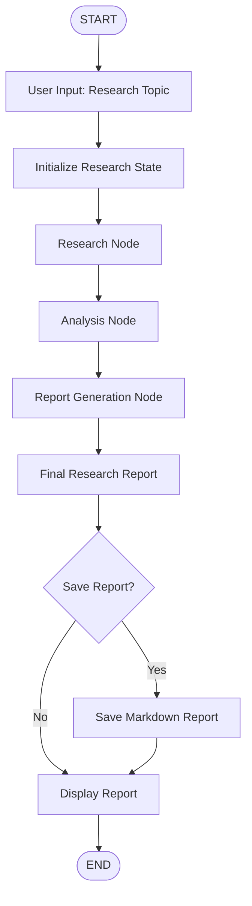
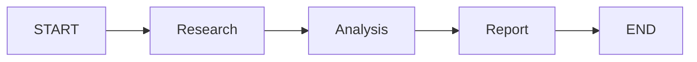
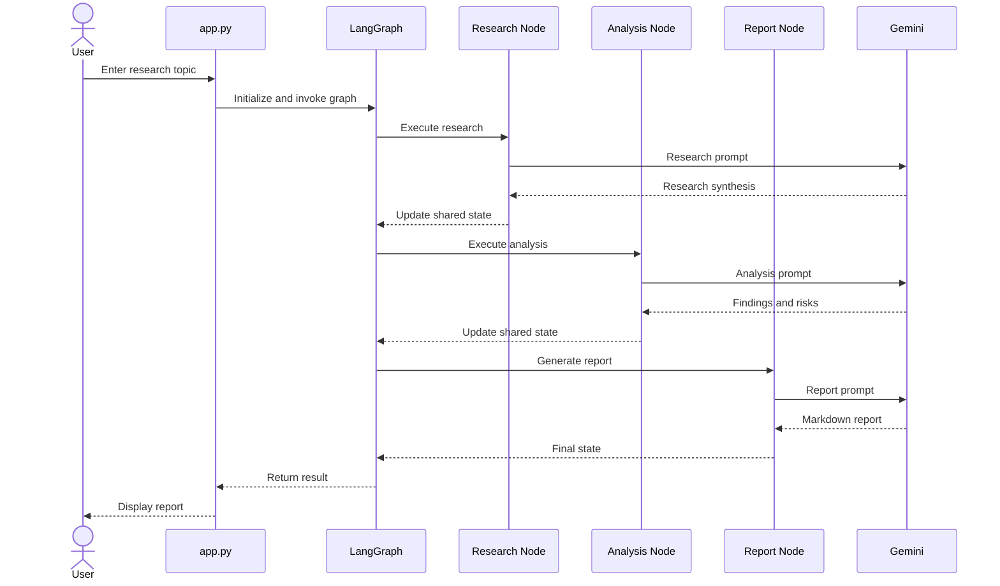
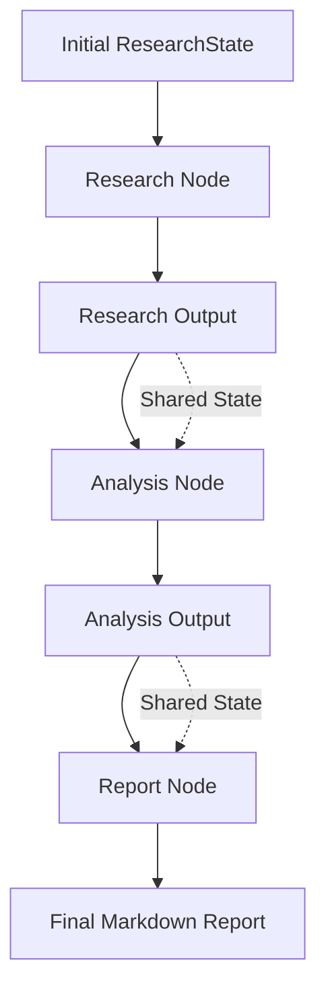
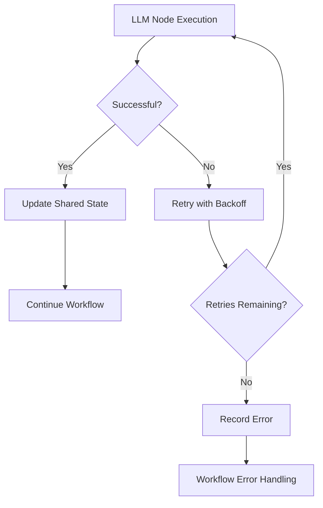

# 🧠 AI Research Intelligence Pipeline

### An AI-Powered Research, Analysis & Report Generation System Built with LangGraph

An intelligent research pipeline that transforms a user-provided research topic into a structured research synthesis, critical analysis, and a professional Markdown report using a sequential LangGraph workflow and Google Gemini.

The project demonstrates graph-based orchestration, shared state management, modular LLM nodes, retry handling, structured reporting, and automated testing with a mock LLM.

---

## 🚀 Overview

The AI Research Intelligence Pipeline automates the process of generating technical research reports.

Given a research topic, the system:

1. **Researches the Topic** — Generates a structured research synthesis covering background, concepts, technical landscape, challenges, applications, and emerging directions.
2. **Analyzes the Research** — Evaluates the research findings to identify opportunities, risks, and engineering insights.
3. **Generates a Report** — Produces a polished Markdown report containing executive summaries, key findings, analysis, recommendations, and conclusions.
4. **Saves the Report** — Allows the user to save the generated report as a Markdown file.

The entire workflow is orchestrated using LangGraph's `StateGraph`.

---

## 🏗️ System Architecture



### LangGraph Workflow



### Node Responsibilities

| Node | Responsibility |
|---|---|
| Research Node | Generates research synthesis from the topic |
| Analysis Node | Identifies findings, opportunities, and risks |
| Report Node | Produces the final structured Markdown report |

---

## 🛠️ Tech Stack

| Technology | Purpose |
|---|---|
| Python | Core programming language |
| LangGraph | Workflow orchestration |
| LangChain Core | LLM integration abstractions |
| Google Gemini | Research, analysis, and report generation |
| python-dotenv | Environment variable management |
| Pytest | Automated testing |
| Logging | Workflow observability |

---

## 📂 Project Structure

```text
01-research-intelligence/
│
├── examples/
│
├── notebooks/
│
├── tests/
│   ├── __init__.py
│   ├── conftest.py
│   ├── fakes.py
│   ├── test_graph.py
│   ├── test_state.py
│   └── test_utils.py
│
├── app.py
├── config.py
├── graph.py
├── nodes.py
├── prompts.py
├── state.py
├── utils.py
│
├── requirements.txt
├── .gitignore
└── README.md
```

### Core Components

- `app.py` — CLI entry point and workflow execution.
- `graph.py` — Builds and compiles the LangGraph workflow.
- `nodes.py` — Contains research, analysis, and report generation nodes.
- `state.py` — Defines the shared research state.
- `prompts.py` — Stores prompts for all LLM operations.
- `config.py` — Manages Gemini configuration, environment variables, retry settings, and logging.
- `utils.py` — Handles report persistence and execution metadata.
- `tests/` — Contains automated tests for workflow, state, and utilities.

---

## 🔄 Execution Flow



---

## 🧩 Shared State Management

The pipeline uses a shared `ResearchState` defined with `TypedDict`.

The state propagates information between the graph nodes without tightly coupling their implementations.



Each node returns only the state fields it owns.

This modular design enables independent node development, testing, and future workflow extensions.

---

## ⚙️ Installation & Setup

### 1. Clone the Repository

```bash
git clone https://github.com/connectwithaadi/GenerativeAI-Learn.git
```

Navigate to the project directory:

```powershell
cd "Langgraph-Projects/01-research-intelligence"
```

### 2. Create a Virtual Environment

```powershell
python -m venv .venv
```

Activate it:

```powershell
.\.venv\Scripts\Activate.ps1
```

### 3. Install Dependencies

```bash
pip install -r requirements.txt
```

### 4. Configure Gemini API Key

Create a `.env` file in the project root.

```env
GOOGLE_API_KEY=your_google_api_key
GEMINI_MODEL=gemini-2.5-flash

LOG_LEVEL=INFO
MAX_RETRIES=3
RETRY_INITIAL_INTERVAL=0.5
RETRY_BACKOFF_FACTOR=2.0
```

Never commit your `.env` file or expose your API key publicly.

---

## ▶️ Running the Application

Start the pipeline:

```bash
python app.py
```

Enter your research topic when prompted.

Example:

```text
Enter research topic: Agentic AI

Workflow started
Research completed
Analysis completed
Report generated
```

The system displays the final research report and asks whether you want to save it.

Default report filename:

```text
research_report.md
```

---

## 🧪 Testing

The project includes an automated test suite using `pytest`.

A mock LLM (`FakeLLM`) is used to simulate model responses, allowing the actual LangGraph workflow to be tested without requiring a Gemini API key or network access.

### Run the Tests

```bash
python -m pytest -v
```

### Test Coverage

- Graph compilation and expected node structure.
- Sequential workflow execution.
- End-to-end state propagation.
- Research output handling.
- Retry recovery after transient failures.
- Error handling after retry exhaustion.
- Initial state validation.
- Independent state initialization.
- Partial state updates.
- Report persistence.
- Execution metadata generation.
- Unique execution identifiers.
- Node completion tracking.

### Test Results

```text
============================= test session starts =============================

collected 14 items

tests/test_graph.py   PASSED
tests/test_state.py   PASSED
tests/test_utils.py   PASSED

============================= 14 passed in 0.82s ==============================
```

*The result above reflects the test execution captured in the project screenshot.*

---

## 🛡️ Reliability & Error Handling

The pipeline implements multiple reliability mechanisms.

- Bounded LLM retries.
- Exponential backoff.
- LangGraph node-level retry policies.
- Error recording in shared state.
- Structured logging.
- Execution metadata tracking.



---

## 📄 Generated Report Structure

The generated Markdown report contains the following sections:

```text
# Executive Summary

# Background

# Key Findings

# Analysis

# Opportunities

# Risks

# Engineering Recommendations

# Conclusion
```

The report is designed to be readable, structured, and suitable for technical research documentation.

---

## 🎯 Key Learning Outcomes

This project demonstrates practical implementation of:

- LangGraph `StateGraph` orchestration.
- Sequential multi-node AI workflows.
- Shared state management using `TypedDict`.
- Modular LLM node design.
- Prompt engineering for research and analysis.
- Dependency injection for LLM clients.
- Retry mechanisms and fault tolerance.
- Logging and execution metadata.
- Automated testing with a mock LLM.
- Markdown report generation.

---

## 🔮 Future Enhancements

Potential future improvements include:

- Integrating real-time web search for source-backed research.
- Adding source citations and reference validation.
- Introducing parallel research agents.
- Implementing human-in-the-loop review.
- Adding streaming responses.
- Developing a Streamlit-based interface.
- Adding persistent workflow checkpoints.
- Integrating LangSmith for tracing and observability.

---

## 👨‍💻 Author

**Aditya Kumar Singh (Aadi)**

- GitHub: [@connectwithaadi](https://github.com/connectwithaadi)

---

⭐ If you find this project useful, consider starring the repository.

